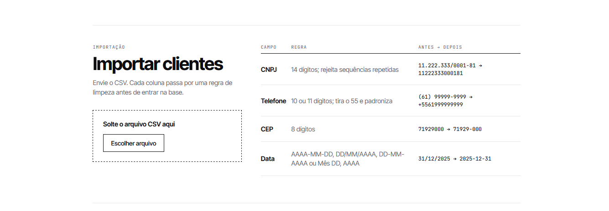
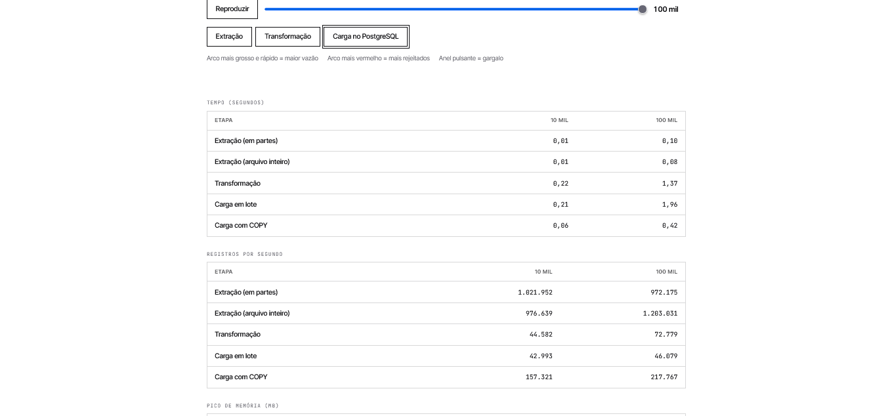

<div align="center">

# VetorFlow

**Pipeline de ETL para extração, tratamento, enriquecimento e carga de dados da Distribuidora Vetor**

Desafio 1 · Empresa Primora · Projeto Integrador Bolsa Futuro Digital

<br>


</div>

<br>

## Sumário

1. [Sobre o projeto](#sobre-o-projeto)
2. [Funcionalidades](#funcionalidades)
3. [Interface do sistema](#interface-do-sistema)
4. [Arquitetura do pipeline](#arquitetura-do-pipeline)
5. [Tecnologias](#tecnologias)
6. [Estrutura de pastas](#estrutura-de-pastas)
7. [Pré-requisitos](#pré-requisitos)
8. [Instalação e configuração](#instalação-e-configuração)
9. [Utilização](#utilização)
10. [API](#api)
11. [Tratamento de dados](#tratamento-de-dados)
12. [Desempenho](#desempenho)
13. [Documentação técnica](#documentação-técnica)
14. [Roadmap](#roadmap)
15. [Autoria](#autoria)

---

## Sobre o projeto

O VetorFlow é uma solução de ETL desenvolvida para o primeiro desafio proposto pela Empresa Primora à Distribuidora Vetor. O objetivo é receber dados brutos e inconsistentes, tratá-los, padronizá-los e enriquecê-los, e então carregá-los em um banco de dados confiável, pronto para consulta e análise.

A aplicação inclui uma interface web para acompanhar a execução do pipeline, consultar os registros tratados e avaliar os resultados e o desempenho de cada processamento.

---

## Funcionalidades

Extração dos dados brutos da Distribuidora Vetor

Limpeza e normalização de campos (textos, documentos, telefones, CEP, datas e valores)

Enriquecimento dos registros por meio de integrações externas

Carga dos dados tratados no PostgreSQL

API para consulta dos registros

Interface web com tela inicial, registros, resultados e métricas de desempenho

Registro de auditoria das execuções

---

## Interface do sistema

### Tela inicial


### Extração do pipeline


### Pipeline



### Registros


### Resultados



---

## Arquitetura do pipeline

```
Extração  →  Transformação  →  Enriquecimento  →  Carga  →  API e Interface
```

| Etapa | Descrição |
|---|---|
| Extração | Leitura dos arquivos de origem da distribuidora |
| Transformação | Normalização dos campos, remoção de duplicidades e tratamento de valores inválidos |
| Enriquecimento | Complemento dos registros com informações de fontes externas |
| Carga | Gravação dos registros tratados no banco de dados |
| Consulta | Exposição dos dados pela API e pela interface web |

---

## Tecnologias

| Camada | Tecnologia |
|---|---|
| Interface | HTML, CSS e JavaScript |
| Pipeline e API | Python, Django e Django REST Framework |
| Banco de dados | PostgreSQL|
| Versionamento | Git e GitHub |

---

## Estrutura de pastas

```
VetorFlow/
├── config/                   Configurações do projeto Django (settings, urls)
├── docs/                     Documentação técnica
│   └── imagens/              Capturas de tela utilizadas neste README
├── manage.py
├── requirements.txt
└── README.md
```

---

## Pré-requisitos

| Ferramenta | Versão mínima |
|---|---|
| [Git](https://git-scm.com/) | 2.x |
| [Python](https://www.python.org/) | 3.10 |
| [PostgreSQL](https://www.postgresql.org/) | 14 |

---

## Instalação e configuração

Os comandos abaixo são para Windows (PowerShell). No Linux ou macOS, ative o ambiente virtual com `source .venv/bin/activate`.

**1. Clonar o repositório**

```powershell
git clone https://github.com/Geovannarn/VetorFlow.git
cd VetorFlow
```

**2. Criar e ativar o ambiente virtual**

```powershell
python -m venv .venv
.venv\Scripts\Activate.ps1
```

**3. Instalar as dependências**

```powershell
pip install -r requirements.txt
```

**4. Configurar o banco de dados**

Crie o banco no PostgreSQL:

```sql
CREATE DATABASE vetorflow;
```

Em seguida, configure as credenciais de acesso em `config/settings.py` (bloco `DATABASES`) ou no arquivo de variáveis de ambiente do projeto.

**5. Aplicar as migrações**

```powershell
python manage.py migrate
```

**6. Disponibilizar os dados de origem**

Copie os arquivos brutos do desafio para a pasta de entrada do projeto, conforme a [estrutura de pastas](#estrutura-de-pastas).

**7. Iniciar o servidor**

```powershell
python manage.py runserver
```

**8. Acessar a aplicação**

```
http://127.0.0.1:8000
```

---

## Utilização

1. Na tela inicial, inicie a execução do pipeline.
2. Acompanhe as etapas de extração, transformação e carga.
3. Consulte os registros tratados na tela de registros.
4. Verifique o resumo do processamento na tela de resultados.
5. Avalie as métricas de execução na tela de desempenho.

---

## API

A API é construída com Django REST Framework. A especificação completa está em [`docs/api.md`](docs/api.md).

URL base: `http://127.0.0.1:8000`

| Método | Endpoint | Operação |
|---|---|---|
| `GET` | `/api/clientes/` | Listar clientes |
| `POST` | `/api/clientes/` | Cadastrar cliente |
| `GET` | `/api/clientes/{id_cliente}` | Consultar cliente |
| `PUT` / `PATCH` | `/api/clientes/{id_cliente}` | Atualizar cliente |
| `DELETE` | `/api/clientes/{id_cliente}` | Excluir cliente |

Para receber a resposta em JSON, adicione `?format=json` à URL:

```
http://127.0.0.1:8000/api/clientes/?format=json
```

---

## Tratamento de dados

As regras aplicadas a cada campo estão documentadas em [`docs/regras-de-tratamento.md`](docs/regras-de-tratamento.md), e as justificativas das escolhas de implementação em [`docs/decisoes-tecnicas.md`](docs/decisoes-tecnicas.md).

---

## Desempenho

A tela de desempenho apresenta as métricas de cada execução do pipeline.


---

## Documentação técnica

| Documento | Conteúdo |
|---|---|
| [API](docs/api.md) | Rotas, parâmetros e respostas |
| [Banco de dados](docs/banco-de-dados.md) | Modelo e estrutura das tabelas |
| [Decisões técnicas](docs/decisoes-tecnicas.md) | Justificativas das escolhas de arquitetura |
| [Regras de tratamento](docs/regras-de-tratamento.md) | Critérios de limpeza e padronização |

---

## Roadmap

Trilha de auditoria por transformação, registrando valor original, valor tratado e critério da decisão

Módulo de benchmark com dados sintéticos de 10 mil a 5 milhões de registros

Verificação de CEP por perímetro

Migração da lógica para Python com Django

---

## Autoria

**Geovanna Rodrigues Nascimento**
Brasília, DF · [github.com/Geovannarn](https://github.com/Geovannarn)

VetorFlow
