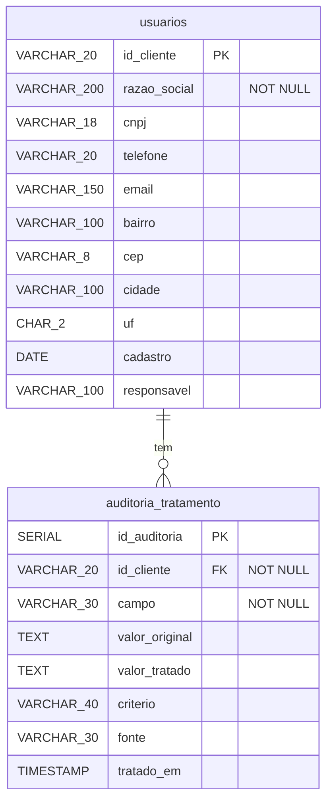

# Documentação do Banco de Dados — VetorFlow

Banco relacional **PostgreSQL**. O script de criação está em [`database/schema.sql`](../database/schema.sql).

## Sumário

1. [Visão geral](#1-visão-geral)
2. [Modelo Entidade-Relacionamento (MER)](#2-modelo-entidade-relacionamento-mer)
3. [Dicionário de dados](#3-dicionário-de-dados)
4. [Relacionamentos](#4-relacionamentos)
5. [Decisões de modelagem](#5-decisões-de-modelagem)
6. [Integridade e restrições](#6-integridade-e-restrições)
7. [Como criar o banco](#7-como-criar-o-banco)
8. [Limitações e evolução](#8-limitações-e-evolução)

## 1. Visão geral

| Tabela | Finalidade | Quem usa |
|---|---|---|
| `usuarios` | Base final de clientes, tratada e padronizada | Pipeline de ETL (escrita) e API REST (leitura e escrita) |
| `auditoria_tratamento` | Trilha de auditoria: valor original → valor tratado → critério e fonte | Pipeline de ETL (escrita) |

## 2. Modelo Entidade-Relacionamento (MER)



## 3. Dicionário de dados

### Tabela `usuarios`

| Coluna | Tipo | Nulo? | Descrição | Formato gravado |
|---|---|:---:|---|---|
| `id_cliente` | `VARCHAR(20)` | Não (PK) | Código único do cliente | Texto, como no CSV |
| `razao_social` | `VARCHAR(200)` | Não | Nome do cliente | Espaços repetidos removidos |
| `cnpj` | `VARCHAR(18)` | Sim | CNPJ do cliente | 14 dígitos, sem máscara |
| `telefone` | `VARCHAR(20)` | Sim | Telefone de contato | `+55` + 10 ou 11 dígitos |
| `email` | `VARCHAR(150)` | Sim | E-mail | Minúsculas, validado |
| `bairro` | `VARCHAR(100)` | Sim | Bairro final | Resolvido entre o informado e o do CEP |
| `cep` | `VARCHAR(8)` | Sim | CEP | 8 dígitos, sem hífen |
| `cidade` | `VARCHAR(100)` | Sim | Cidade | Preenchida pelo CEP se ausente |
| `uf` | `CHAR(2)` | Sim | Unidade federativa | 2 letras maiúsculas |
| `cadastro` | `DATE` | Sim | Data de cadastro | ISO (`AAAA-MM-DD`) |
| `responsavel` | `VARCHAR(100)` | Sim | Vendedor responsável | Texto |

### Tabela `auditoria_tratamento`

Cada linha registra **uma decisão de tratamento aplicada a um campo de um cliente**.

| Coluna | Tipo | Nulo? | Descrição |
|---|---|:---:|---|
| `id_auditoria` | `SERIAL` | Não (PK) | Identificador sequencial da linha de auditoria |
| `id_cliente` | `VARCHAR(20)` | Não (FK) | Cliente ao qual a decisão se refere |
| `campo` | `VARCHAR(30)` | Não | Campo tratado (ex.: `bairro`, `telefone`, `cnpj`) |
| `valor_original` | `TEXT` | Sim | Valor como veio no CSV |
| `valor_tratado` | `TEXT` | Sim | Valor gravado em `usuarios` (`NULL` se foi anulado) |
| `criterio` | `VARCHAR(40)` | Sim | Regra aplicada (ex.: `convergente`, `informado`, `api`, `divergente`, `sem informação`) |
| `fonte` | `VARCHAR(30)` | Sim | Origem da decisão (ex.: `cliente`, `viacep`, `brasilapi`, `normalização`) |
| `tratado_em` | `TIMESTAMP` | Sim | Data e hora do tratamento (padrão: momento da inserção) |

**Exemplo de consulta:** por que o cliente 15 ficou com aquele bairro?

```sql
SELECT campo, valor_original, valor_tratado, criterio, fonte
FROM auditoria_tratamento
WHERE id_cliente = '15';
```

<!-- ATUALIZAR: confirmar os valores reais usados em "campo" e "fonte" depois que o pipeline passar a gravar nesta tabela. -->

## 4. Relacionamentos

| Relacionamento | Cardinalidade | Chave estrangeira | Regra de exclusão |
|---|:---:|---|---|
| `usuarios` → `auditoria_tratamento` | **1:N** | `auditoria_tratamento.id_cliente` → `usuarios.id_cliente` | `ON DELETE CASCADE` |

Um cliente pode ter várias linhas de auditoria (uma por campo tratado), e cada linha de auditoria pertence a um único cliente. Ao excluir um cliente, suas linhas de auditoria são excluídas junto, para que a exclusão pela API não seja bloqueada.

## 5. Decisões de modelagem

1. **Tabela principal única para o cliente (`usuarios`).** O dataset descreve uma só entidade, sem entidades auxiliares. Evita junções desnecessárias nas consultas e na carga.
2. **Auditoria em tabela própria, e não em colunas de `usuarios`.** Um cliente tem vários campos tratados, e cada um precisa de valor original, valor tratado, critério e fonte. Colocar isso em `usuarios` multiplicaria as colunas. A tabela separada mantém `usuarios` limpa e responde, para qualquer registro, por que ele ficou daquele jeito (critério de rastreabilidade do desafio).
3. **Formato "uma linha por campo tratado"** (e não uma linha por cliente), permitindo consultar a história de um único campo e acrescentar novos tipos de tratamento sem alterar a estrutura.
4. **Chave primária textual (`id_cliente`).** Mantém o código original do cliente, preservando a rastreabilidade com o arquivo de origem.
5. **Apenas dois campos obrigatórios em `usuarios`.** `id_cliente` e `razao_social` são os únicos `NOT NULL`. O pipeline transforma dados inválidos em `NULL` em vez de rejeitar o cliente (ver `decisoes-tecnicas.md`, D8).
6. **Tamanhos das colunas.**
   - `cep VARCHAR(8)`: o CEP é gravado sem hífen.
   - `telefone VARCHAR(20)`: comporta `+55` e 11 dígitos, com folga.
   - `cnpj VARCHAR(18)`: comporta o CNPJ com máscara, embora o pipeline grave só 14 dígitos.
   - `uf CHAR(2)`: tamanho fixo.
7. **CEP, CNPJ e telefone como texto**, e não números, para não perder zeros à esquerda e por não serem usados em cálculos.
8. **`cadastro` como `DATE`**, permitindo ordenar e filtrar por período.
9. **`ON DELETE CASCADE` na auditoria.** Priorizou-se manter a exclusão de clientes funcionando. A consequência é que a trilha de auditoria de um cliente excluído também é perdida (ver seção 8).

## 6. Integridade e restrições

| Restrição | Onde | Efeito |
|---|---|---|
| `PRIMARY KEY` | `usuarios.id_cliente` | Impede dois clientes com o mesmo código |
| `NOT NULL` | `usuarios.razao_social` | Exige nome do cliente |
| `PRIMARY KEY` (serial) | `auditoria_tratamento.id_auditoria` | Identifica cada linha de auditoria |
| `FOREIGN KEY` | `auditoria_tratamento.id_cliente` | Impede auditoria de cliente inexistente |
| `NOT NULL` | `auditoria_tratamento.id_cliente` e `campo` | Toda linha de auditoria tem cliente e campo |
| `ON DELETE CASCADE` | `auditoria_tratamento.id_cliente` | Remove a auditoria ao excluir o cliente |
| Tamanho máximo | Colunas `VARCHAR` | Textos maiores geram erro `22001`, traduzido pela API |
| `ON CONFLICT (id_cliente) DO NOTHING` | Carga do pipeline | Torna a carga repetível sem duplicar registros |

A API converte erros do banco em respostas legíveis (códigos `23502`, `23505`, `22001` e `22P02`).

## 7. Como criar o banco

```bash
# 1. criar o banco (o nome padrão esperado pelo projeto é VetorFlow)
createdb VetorFlow

# 2. aplicar o esquema
psql -d VetorFlow -f database/schema.sql
```

As tabelas são criadas com `CREATE TABLE IF NOT EXISTS`, então o script pode ser executado novamente sem apagar dados. A `auditoria_tratamento` vem **depois** da `usuarios` no arquivo, porque referencia a chave dela.

A conexão é configurada por variáveis do arquivo `.env` (modelo em `.env.example`):

| Variável | Valor padrão |
|---|---|
| `DB_NAME` | `VetorFlow` |
| `DB_USER` | `postgres` |
| `DB_PASSWORD` | *(vazio)* |
| `DB_HOST` | `localhost` |
| `DB_PORT` | `5432` |

## 8. Limitações e evolução

- **A auditoria é apagada junto com o cliente** (`ON DELETE CASCADE`). Em um sistema real, seria preferível manter o histórico, por exemplo com exclusão lógica (coluna `ativo`) em vez de exclusão física.
- **Sem índices além das chaves primárias.** Consultas por bairro, CEP ou CNPJ varrem a tabela inteira, o que é aceitável no volume atual. Para a auditoria, um índice em `auditoria_tratamento(id_cliente)` aceleraria as consultas por cliente.
- **Sem restrição de unicidade em `cnpj`**, pois dois cadastros podem legitimamente repetir o mesmo CNPJ nos dados fictícios.
- **Campos de auditoria sem lista fixa.** `campo`, `criterio` e `fonte` são texto livre; uma evolução seria restringi-los com `CHECK` ou tabelas de domínio.